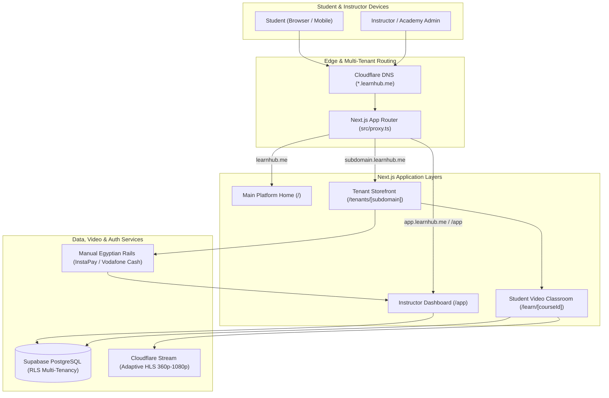

# 🎓 LearnHub (منصة ليرن هب التعليمية)
### Multi-Tenant LMS & Dynamic Academy Website Builder for Egypt & MENA
> Built strictly against the requirements in [edtech_platform_srad.pdf](edtech_platform_srad.pdf). Supports **English & Arabic (العربية)** out-of-the box with full RTL support.

---

## 🌟 1. What is LearnHub? (High-Level Overview)

In Egypt and the MENA region, private tutors and academies spend thousands of dollars to create custom educational apps, or rely on platforms that take hefty cuts and require international credit cards that Egyptian students don't have.

**LearnHub** solves this with a **$0 Initial Overhead Strategy**:
1. **White-Label Storefronts in 60 Seconds**: Any teacher or academy gets a shareable storefront path (e.g., `instruct-hub.vercel.app/tenants/physics-pro`), with custom domains planned for production setup.
2. **Instant Website Activation & Easy Sharing**: Once setup & plan payment are confirmed, the website is live and public worldwide. Instructors can share their link directly to student WhatsApp groups or generate a printable QR Code for center booklets.
3. **Student Login with Phone Number + PIN (تسجيل الدخول برقم الموبايل والرقم السري)**: No email required. Egyptian high school and prep students simply enter their 11-digit mobile number and a 4-digit PIN to access their courses.
4. **100% Localized Egyptian Payments**: Egyptian students don't need credit cards. They pay via **InstaPay** or **Vodafone Cash**, upload a screenshot of their transaction, and the instructor unlocks the course with a single click.
5. **Adaptive Video Streaming with 360p Data Saver**: High-definition video powered by **Cloudflare Stream (HLS)** that automatically scales down to 360p (~180MB/hour) so students don't deplete their expensive mobile data packages.
6. **Course-Grounded AI Assistant**: An embedded AI teaching assistant grounded strictly on the instructor's lecture transcripts and notes to answer students 24/7.
7. **Arabic First (دعم كامل للغة العربية)**: Seamless language switcher with RTL layout support tailored for Egyptian curriculum (Thanaweya Amma, Prep, and University courses).

---

## 🏛️ 2. Core Architecture & How It Works



---

## 🚀 3. Features Implemented (By Epic)

### 🟢 Epic 1: Instructor Onboarding & Branding (60s Setup)
* **File:** [`src/app/page.tsx`](src/app/page.tsx)
* **What it does:**
  * Teachers enter their desired subdomain (e.g. `cairo-prep`).
  * Pick their academy brand accent color (Sky, Emerald, Purple, Amber, Rose).
  * Choose their subscription tier.
  * Instant launch into their management portal.

### 🟢 Epic 2: The Student Experience & Adaptive Video
* **Tenant Storefront:** [`src/app/tenants/[subdomain]/page.tsx`](src/app/tenants/[subdomain]/page.tsx)
  * Unique branding, logo, customized headline, and syllabus list.
* **Curriculum & Previews:** [`src/app/tenants/[subdomain]/courses/[courseId]/page.tsx`](src/app/tenants/[subdomain]/courses/[courseId]/page.tsx)
  * Free preview lessons accessible without login; locked lessons require enrollment.
* **Cloudflare Stream Player:** [`src/components/CloudflareStreamPlayer.tsx`](src/components/CloudflareStreamPlayer.tsx)
  * Adaptive bitrate engine with a **360p Data Saver mode** for Egyptian 4G mobile networks.
* **Classroom & Course AI:** [`src/app/tenants/[subdomain]/learn/[courseId]/page.tsx`](src/app/tenants/[subdomain]/learn/[courseId]/page.tsx)
  * Interactive playlist, lecture completion checkmarks, and embedded course-grounded AI bot.

### 🟢 Epic 3: Localized Egyptian Checkout & Instructor Dashboard
* **Manual Checkout Component:** [`src/components/ManualPaymentCheckout.tsx`](src/components/ManualPaymentCheckout.tsx)
  * Students select **InstaPay** (copies tutor's IPA username/account) or **Vodafone Cash** (copies wallet number).
  * Uploads screenshot proof of transfer (up to 2 MB) and places it in the instructor's review queue.
* **Instructor Dashboard:** [`src/app/app/page.tsx`](src/app/app/page.tsx)
  * **Manual Verification Queue**: Review uploaded receipts and approve or reject enrollment requests. Approved students can access paid classroom lectures; free previews remain public.
  * **Quota Guardrail Matrix**: Live tracking of Cloudflare storage and active student counts against plan limits.
  * **Course & Lecture Creator**: Upload video lectures with Cloudflare Stream IDs and check storage quota limits before saving.

---

## 💰 4. Pricing & Quota Guardrail Matrix (Section 5 of SRAD)

| Plan | Monthly Fee | Transaction Fee | Storage Quota | Active Students | Features |
| :--- | :--- | :--- | :--- | :--- | :--- |
| **Basic** | **$0 / 0 EGP** | 5% per sale | **3 GB** | Up to **50** | Manual payment approval, 360p stream, perfect for market validation |
| **Pro** | **250 EGP / mo** | 2% per sale | **15 GB** | Up to **500** | Custom branding, priority video processing |
| **Academy** | **750 EGP / mo** | 0% | **100 GB** | **Unlimited** | Multi-instructor management, custom domains, direct payout rails |

---

## 🗄️ 5. Database Schema & Security (PostgreSQL / Supabase)

Migration file: [`supabase/migrations/20261102_init_edtech_schema.sql`](supabase/migrations/20261102_init_edtech_schema.sql)

* **`organizations`**: Multi-teacher academies and school institutes.
* **`tenants`**: Subdomain mapping (`subdomain.learnhub.me`), custom domain, theme settings JSONB, and live storage counters.
* **`profiles`**: Tied to Supabase Auth (`student`, `teacher`, `organization_admin`).
* **`courses`**: Course metadata, EGP pricing, and publishing status.
* **`lectures`**: Cloudflare Stream IDs, byte size (for quota enforcement), sort order, and free preview flags.
* **`enrollments`**: Student course purchases with payment status (`pending`, `approved`, `rejected`) and receipt screenshot URLs.
* **Row-Level Security (RLS)**:
  * Public can read tenant metadata and published course info.
  * Only enrolled & approved students can view paid lecture stream tokens.
  * Teachers can only manage courses and review receipts for their own tenant.

> **Prototype note:** The current UI uses browser `localStorage` for student sessions and enrollment review state. Checkout, instructor approval, and classroom access therefore work only in the same browser profile; Supabase is not yet wired into these screens. Do not use this client-side demo flow for production payments or access control.

---

## 📂 6. Project Directory Tour

```text
learnhub/
├── edtech_platform_srad.pdf            # Authoritative architecture reference document
├── postcss.config.mjs                  # Tailwind CSS v4 PostCSS compilation config
├── next.config.ts                      # Next.js 16 configuration
├── supabase/
│   └── migrations/
│       └── 20261102_init_edtech_schema.sql # PostgreSQL multi-tenant schema & RLS rules
└── src/
    ├── proxy.ts                        # Subdomain routing proxy (Next.js 16 convention)
    ├── types/
    │   └── database.ts                 # TypeScript interfaces for schema & quotas
    ├── lib/
    │   ├── data-store.ts               # Local mock data store & quota calculation engine
    │   ├── i18n.ts                     # English & Egyptian Arabic translations dictionary
    │   └── supabase/
    │       └── client.ts               # Supabase JavaScript client setup
    ├── components/
    │   ├── CloudflareStreamPlayer.tsx  # HLS video player with 360p data saver mode
    │   ├── ManualPaymentCheckout.tsx   # InstaPay & Vodafone Cash receipt checkout
    │   └── LanguageToggle.tsx          # Arabic (العربية) / English switcher button
    └── app/
        ├── layout.tsx                  # Global layout with Geist font & dark theme
        ├── globals.css                 # Base Tailwind CSS v4 styling rules
        ├── page.tsx                    # Platform landing page + 60s onboarding
        ├── app/
        │   └── page.tsx                # Instructor Dashboard & verification queue
        └── tenants/
            └── [subdomain]/
                ├── page.tsx            # Branded tenant storefront
                ├── courses/
                │   └── [courseId]/
                │       └── page.tsx    # Course syllabus & checkout page
                └── learn/
                    └── [courseId]/
                        └── page.tsx    # Classroom video player & AI tutor
```

---

## ⚡ 7. How to Run & Test Locally

### 1. Install Dependencies
```bash
cd ~/Documents/learnhub
npm install
```

### 2. Start the Development Server
```bash
npm run dev
```

### 3. Test the App in Your Browser
* **Main Landing & Academy Creator:** [http://localhost:3000](http://localhost:3000)
  * Click the **"العربية" / "English"** button in the header to switch languages instantly.
  * Test creating a new subdomain in 60 seconds.
  * Student share links use `NEXT_PUBLIC_APP_URL` (defaults to `https://instruct-hub.vercel.app`) followed by `/tenants/<slug>`.
* **Instructor Portal:** [http://localhost:3000/app](http://localhost:3000/app)
  * Review pending receipts, click **Approve** or **Reject**, view live quota bars, and test adding lectures.
* **End-to-end payment demo:** On the course page, sign in with demo student `01011223344` / PIN `1234`, upload an image receipt (2 MB maximum), and submit. The request appears in the instructor portal in the same browser profile. Approve it, then reload the classroom to unlock paid lectures. The demo student `01122334455` / PIN `5678` is already approved.
* **Live Tenant Storefronts:**
  * **Physics Academy Demo:** [http://localhost:3000/tenants/physics-pro](http://localhost:3000/tenants/physics-pro)
  * **Course Details & Checkout:** [http://localhost:3000/tenants/physics-pro/courses/course-phy-101](http://localhost:3000/tenants/physics-pro/courses/course-phy-101)
  * **Student Classroom & AI Bot:** [http://localhost:3000/tenants/physics-pro/learn/course-phy-101](http://localhost:3000/tenants/physics-pro/learn/course-phy-101)

### 4. Build for Production
```bash
npm run build
```
Run `npm run lint` and `npx tsc --noEmit` to check lint and TypeScript status.
